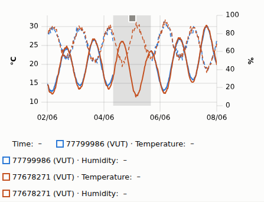
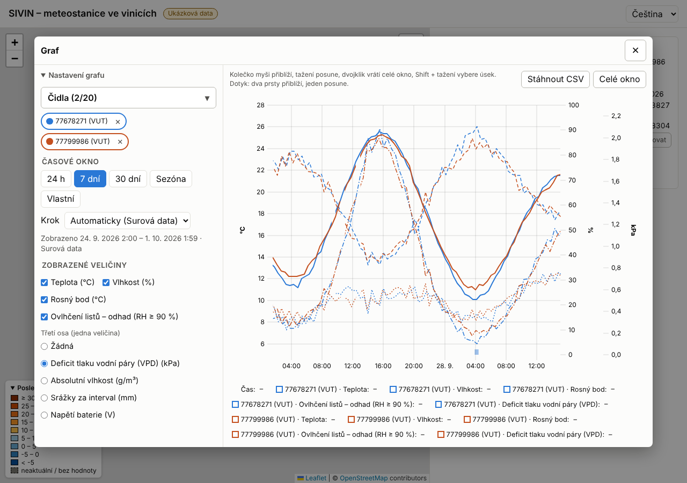

# Web portal (`web/`)

Static map portal for the SIVIN vineyard weather sensors. It is served by GitHub Pages at
`https://ricredi.github.io/SIVIN_Mateostations/` and reads only static JSON files that follow the
site data contract, [MIGRATION_PLAN.md §2.6](../MIGRATION_PLAN.md) (`schema_version: 1`). There
is no server and no API key.

Stack: TypeScript (`strict`, `noUncheckedIndexedAccess`), Vite, Leaflet (map) with
`leaflet.markercluster` (marker clustering, bundled), uPlot (time series), ESLint (typescript-eslint, strict type-checked), Vitest (+ jsdom for DOM components).
No UI framework: components are plain TypeScript classes that own a DOM subtree.

## Run locally

```bash
cd web
npm ci
npm run dev         # http://localhost:5173/SIVIN_Mateostations/
npm run lint && npm run typecheck && npm test && npm run build   # the CI gates
npm run preview     # serves dist/ at http://localhost:4173/SIVIN_Mateostations/
npm run fixture     # regenerates the synthetic data in public/data/
npm run screenshot  # with `npm run preview` running: docs/wp_log/img/WP-3.1-*.png
```

`npm run screenshot` uses `playwright-core` with an existing Chromium (`CHROMIUM_PATH`, default
`/opt/pw-browsers/...` in the agent sandbox); it never downloads a browser.

### Base path

`vite.config.ts` sets `base: process.env.SITE_BASE ?? '/SIVIN_Mateostations/'`. All asset URLs and
the data URL (`${import.meta.env.BASE_URL}data/`) are prefixed with it. For a different host path
build with e.g. `SITE_BASE=/ npm run build`.

## Architecture

```
main.ts  (composition root: builds every object, injects collaborators through constructors)
  │
  ├─ data/      DataClient ── fetch + cache + validate ──► contract/ (types + validators)
  ├─ domain/    TimeSeries, RawSeries, Resampler, QcMask, TimeZone,
  │             TimeWindow, WindowSpec, TimeWindowFactory, ResolutionPolicy, alignSeries,
  │             psychrometry, derivedSeries, quantities, ViewRange
  ├─ app/       SensorCatalog, SensorGrouping, SensorQuery,
  │             ChartDataLoader, ChartPresenter, ChartQuantities, CsvWriter   (no DOM)
  ├─ state/     Store<T>, AppState, GroupSelection, QuantitySelection, HashStateCodec (no DOM)
  ├─ i18n/      I18n, LanguagePreference, cs/de/en dictionaries
  └─ ui/        App, HeaderView, MapView, ClusterIcon, SensorPanel, TimeWindowControl,
                SeriesChart, ChartModel, ZoomPanPlugin, WetnessBands, EventMarkers,
                ChartToolbar, ChartDialog, QuantityControl, QuantityLabels, ChartCsv,
                FileDownload, SensorColors, HashSync, palette, dom
                picker/  SensorPicker, PickerTree, SensorChips
```

Dependencies point downwards only: `ui` → `app` → `domain`/`data` → `contract`. There are no
globals or singletons; `main.ts` is the only place that touches `window`, `fetch` and
`localStorage` directly and passes them in.

| Class / module | Responsibility |
|---|---|
| `contract/types.ts` | TypeScript mirror of §2.6 (`Manifest`, `LatestFile`, `RawMonthFile`, `DailyFile`, `EventsFile`, `IndicesFile`, `SensorsGeoJSON` with the registry properties of §2.4). |
| `contract/validate*.ts`, `FieldReader`, `ContractError` | Hand-written runtime validation of every file. A mismatch throws `ContractError` with file, JSON path and problem, e.g. `manifest.json: $.schema_version must be one of [1], got 2`. Unknown extra fields are ignored (forward compatible); an event of an unknown `type` is skipped with a console warning (WP-3.2); a malformed *optional* field is ignored with a warning; `schema_version` must be exactly 1. |
| `data/DataClient` | Fetches contract files relative to the data base URL, validates and caches them (one request per file per page load; failed requests are retried on the next call). `getRawRange(id, start, end)` picks the **UTC** months overlapping `[start, end)` that the manifest lists, fetches them in parallel and merges them into one `RawSeries`. A listed month that cannot be loaded is an error; months not listed are skipped. |
| `domain/RawSeries` | Columnar raw samples of one sensor, merged from monthly files, sorted by `t`, one sample per time. |
| `domain/TimeSeries` | Immutable value object of one variable (`t[]`, `values[]`, `null` = no valid value). `withGapBreaks` inserts `null` where samples are too far apart so charts draw gaps. |
| `domain/QcFlags` | `QcFlag` bits, `DEFAULT_EXCLUDE_MASK` = MISSING \| OUT_OF_RANGE \| SPIKE \| STUCK \| PRE_DEPLOYMENT \| MANUAL_EXCLUDE (§2.7) and the web's `DISPLAY_EXCLUDE_MASK` (equal to it, see below); `QcMask` decides exclusion. |
| `domain/Resampler` | Raw → chart series: QC-masked raw values (gap threshold 3 × 1830 s, `NOMINAL_STEP_S`), or hourly means (hourly **sums** for precipitation) over UTC hours, stamped at the **centre** of the hour (`h + 1800`) so they line up with raw samples; an hour without valid values is `null`. Temperature and humidity use the display mask, precipitation and battery voltage `AUXILIARY_DISPLAY_EXCLUDE_MASK` (below). Daily values are not computed in the browser; they come from `daily.json` and are drawn at local noon, the centre of the day. |
| `domain/psychrometry` | Pure formulas of the derived quantities: dew point (Magnus, Alduchov & Eskridge 1996), saturation and actual vapour pressure and VPD (FAO-56), absolute humidity (ideal-gas law), the leaf-wetness proxy `RH >= 90 %`. Same constants as the Python indices; `RH <= 0` gives `null`. |
| `domain/derivedSeries` | `combineSeries` (a quantity from temperature and humidity at the same times; `null` stays `null`), `leafWetnessIndicator` (1/0/`null`), `wetIntervals` (bands of wet points). |
| `domain/quantities` | Ids of the chart quantities, which of them need an extra axis, the default (temperature and humidity). |
| `domain/ViewRange` | The visible part of the time axis and the zoom/pan arithmetic (zoom around an anchor, pan, clamp to the loaded window, minimum span = 4 point spacings of the resolution, wheel factor). |
| `domain/TimeZone` | Unix seconds ↔ wall-clock time of an IANA zone via `Intl` (DST-aware): local midnights, shifting by local days. |
| `domain/WindowSpec`, `TimeWindow`, `TimeWindowFactory`, `ResolutionPolicy` | What the user asked for (`24h` / `7d` / `30d` / `season` / `custom`) → a concrete `[startT, endT)` with a resolution. Details below. |
| `domain/alignSeries` | Puts several series on one union time axis for uPlot (`undefined` = no sample, skipped; `null` = gap). |
| `app/SensorCatalog` | Joins `sensors.geojson`, manifest and `latest.json` into `SensorInfo` per sensor (position, elevation, `municipality`, `track`, `variety`, registry `status`, latest values). |
| `app/SensorGrouping` | Groups sensors municipality → vineyard track for the picker: names in Czech collation with natural number order (`Trať 2` before `Trať 10`), the unassigned group (`null`) last; within a track by label, retired sensors last. |
| `app/SensorQuery` | The picker's search: every word of the query must occur in id, label, municipality, track or variety; case and diacritics are ignored (`foldText`: NFD, combining marks removed, lower case). |
| `state/GroupSelection` | Tri-state of a group (`none` / `some` / `all`) and the group checkbox within the comparison limit: a group with **any** selected sensor is cleared (so a partly selected group can always be cleared, also at the limit); a group without one is added in group order up to 8 and the rest is reported (`groupNotice`: "only n added", or the plain limit message when nothing fit). |
| `app/ChartDataLoader` | Loads raw / hourly / daily series and in-window events **per sensor** (`Promise.allSettled`): a sensor whose series fail becomes a failure entry shown as a per-sensor error above the chart, the other sensors still render. A missing or invalid events file degrades to "no events" with a `console.warn`. |
| `app/ChartQuantities` | `ChartQuantity` (abstract: id, unit, axis, line style, decimals, label key per resolution, `series(sensor)`) with `MeasuredQuantity`, `PsychrometricQuantity`, `LeafWetnessQuantity`, and the `QuantityRegistry` filled by `createQuantityRegistry`. A new quantity is a new registered instance. |
| `app/CsvWriter` | CSV text: UTF-8 BOM, `;`, CRLF, RFC 4180 quoting, numbers with fixed decimals and the decimal mark of the language. |
| `app/ChartPresenter` | Resolves the window from the state (falling back to the default window if a spec cannot be resolved), shows "loading", the data or an error; drops responses of superseded requests. |
| `state/Store`, `AppState`, `HashStateCodec` | Observable immutable state (selection, window, resolution, shown chart quantities, language) and its URL-hash form, e.g. `#s=77678271,77680921&w=7d&r=hourly&lang=cs`, `#w=season&y=2026`, `#w=custom&from=2026-06-01&to=2026-06-15`, `#…&q=temp_c,dew_point_c,vpd_kpa`. `r` is omitted for automatic resolution, `q` for the default temperature + humidity (`q=` = nothing shown). Store notifications are not re-entrant: an update made inside a listener is applied at once but notified after the current change. The codec accepts only real calendar dates (they must round-trip through `Date`) and years 2000–2100; anything else in the hash is ignored. |
| `i18n/I18n`, `LanguagePreference` | UI strings cs (default) / de / en, manifest labels, number/date formatting. Lookup: language → Czech → key. The language is stored in `localStorage` (every access in `try/catch`). Priority at start: URL hash → stored preference → Czech. |
| `ui/MapView` | Leaflet map, OSM tiles (layer switch to OpenTopoMap), fit to sensors, circle markers coloured by latest temperature, grey with dashed outline when `stale` or missing, tooltip (label, value, local time), legend as a `<details>` element (collapsed by default below 600 px). Click selects one sensor, ctrl/⌘-click toggles it in the comparison. Markers are keyboard controls: `role="button"`, in the tab order, accessible name "label: value", `aria-pressed` for the selection; Enter/Space selects, Ctrl/⌘ + Enter/Space compares. **Clustering** (`leaflet.markercluster`, see *Clustering* below): markers closer than `CLUSTER_RADIUS_PX` (42 px) on screen merge into a badge with the count, coloured by the **mean latest temperature** of its members on the marker scale; a click on a badge, or Enter on a focused one, zooms in to its sensors (at the highest zoom it spreads them). A badge that hides a selected sensor has a blue ring. Leaflet re-creates a marker's element when it leaves a cluster, so the keyboard attributes are re-applied on every `add`. |
| `ui/ClusterIcon` | Content of a cluster badge: the count, an accessible name ("Skupina čidel: 5 – přiblížit"), the colour (below) and the selection ring. |
| `state/QuantitySelection` | Normalising (known ids, canonical order, at most one extra-axis quantity) and toggling the shown quantities. |
| `ui/SensorPanel` | Right-hand panel (bottom sheet ≤ 760 px, collapsible): sensor picker, metadata (incl. municipality and track) and latest values of the selected sensors, time-window controls, chart quantities, chart. |
| `ui/picker/SensorPicker` | Sensor selection that scales to larger networks (WP-3.5), details below. |
| `ui/picker/PickerTree` | The grouped checkbox list (composite of group nodes and sensor rows). The DOM is built once; `update` only shows, hides and checks, so focus stays where it is while typing or toggling. |
| `ui/picker/ModalSheet` | Makes the open panel modal in the phone layout: `role="dialog"`, `aria-modal="true"`, every other part of the page `inert`, Tab / Shift+Tab wrap inside the sheet; all undone on close. |
| `ui/ClusterIcon` (colours) | `appearance(tempsC, selectedCount)`: mean of the members' current temperatures (stale or missing ones ignored) on `TemperatureScale`; grey `STALE_COLOR` with a dashed ring only when no member has a value; text dark or white, whichever has the higher WCAG contrast (`inkFor`). |
| `ui/picker/SensorChips` | The selected sensors as removable chips in their line colour, in selection order; they double as the chart legend. |
| `ui/TimeWindowControl` | Preset buttons (`aria-pressed`), season year, custom from–to form, resolution selector whose "automatic" entry names the resolution it picks, and a line with the concrete window and resolution actually shown ("Zobrazeno 24. 9. 2026 0:00 – 30. 9. 2026 23:59 · Surová data"; the end shown is the last minute inside the half-open window). |
| `ui/SeriesChart` | uPlot chart of the shown quantities: temperature and dew point on the left axis (°C), relative humidity on the right axis (%), at most one more quantity on a third axis, leaf wetness as bands; one colour per compared sensor, one line style per quantity; x axis in the display time zone, resizes with its container (fills the dialog), per-sensor load errors above it. Only the canvas has `role="img"` and a name; the legend table and event buttons stay in the accessibility tree. |
| `ui/ChartModel` | What the chart draws and the CSV writes: one aligned time axis, a column per sensor × quantity (blanked in off-site periods), off-site and wetness bands, the rows inside a view. |
| `ui/ZoomPanPlugin` | uPlot plugin: wheel zoom (once per animation frame), drag pan, Shift + drag selection, double-click reset, pinch zoom; owns the x range. |
| `ui/WetnessBands` | Draws the leaf-wetness lanes (`drawClear` hook). |
| `ui/ChartToolbar`, `ChartExport` | Buttons "⤢" (maximise), "Celé okno" (reset zoom), "Stáhnout CSV" and the zoom hint; the export action. |
| `ui/ChartDialog` | The maximised chart: moves the chart and its controls into a modal dialog and back. |
| `ui/QuantityControl`, `QuantityLabels` | Check boxes and third-axis radio buttons for the quantities; their labels (manifest labels for temperature and humidity). |
| `ui/ChartCsv`, `FileDownload` | The CSV of the visible data and its file name; saving it as a Blob download. |
| `ui/EventMarkers` | Sensor events on the chart: dashed vertical lines plus one focusable button per event with an accessible name and a tooltip (type, sensor, time, confidence, detail); amber buttons for the advisory intervals `low_battery` and `unlogged_off_site` (the latter only if the pipeline is configured to publish it), grey bands for `off_site` (below). |
| `ui/SensorColors` | Line colours of the compared sensors, assigned in selection order; a sensor keeps its colour while selected, a new one takes the first free colour, so the (at most 8) compared sensors never share a colour. |
| `ui/HeaderView` | Title, "demo data" badge, language switch. |
| `ui/App` | Coordinates store and views: user actions update the store, changes re-render views and reload the chart. |
| `ui/HashSync` | Two-way binding between store and `location.hash` (`replaceState`, no history spam). |

### Sensor picker

Owner decision 2026-10-05: the selection must scale beyond a handful of sensors. The panel shows

- a **disclosure button** "Čidla (n/N) ▾" (`aria-expanded`, `aria-controls`). It opens a panel
  with a **search field** (focused on open) and the sensors grouped **municipality → vineyard
  track** (`municipality`, `track` of the registry; a sensor without a value is listed under
  *Nezařazeno* on that level). Each group has a disclosure button with its name and
  "selected/visible" count, and a **tri-state checkbox** over its *visible* sensors. A group
  without a selected sensor is added in list order until 8 sensors are selected, with a notice
  how many were added ("Srovnat lze nejvýše 8 čidel – ze skupiny bylo přidáno jen 6."; just
  "Srovnat lze nejvýše 8 čidel." when nothing fit). A group with **any** selected sensor
  (checked or mixed) is cleared by its checkbox, so a partly selected group can always be
  cleared, also at the limit.
- **Search** filters by id, label, municipality, track and variety, case- and
  diacritics-insensitive: every word of the query must be the **start of a word** of one of
  those fields ("ryzl mik"; "obec b trat 4" finds Obec B / Trať 4 only — "b" does not match
  inside "obec", "4" not inside an id "90000401"). Words are split at anything that is not a
  letter or digit. Starting a search expands all groups. During a search the group checkbox
  acts on the matches, and says so: its name is "Vybrat nalezená v <group>", its state
  refers to the matches, and a hint "nalezeno m z n" next to the name shows how many of the
  group's sensors match.
- Retired sensors are listed last in their track and greyed (not struck through: their data are
  kept), with "vyřazeno"; the variety is shown under the label.
- **Limit notice** once, in the picker: inside the open panel, else right under the button
  (the side panel no longer repeats it).
- **Chips** below the button: the compared sensors in their line colour with a × button
  ("Odebrat … ze srovnání"); removing one moves focus to the next chip, or to the button.
- **Keyboard:** Tab through the controls (native checkboxes and buttons), ↓/↑ move between the
  visible controls of the open panel, Escape closes it and returns focus to the button; a click
  outside closes it. On phones (≤ 760 px, `PHONE_LAYOUT_QUERY` in `main.ts`, checked on each
  opening) the open panel is a **modal full-screen sheet** (`ModalSheet`): `role="dialog"`,
  `aria-modal="true"`, the rest of the page `inert`, Tab trapped inside, a title
  "Výběr čidel (n/N)" and a "Hotovo" button; closing restores everything and returns focus to
  the button.
- The selection stays in the URL hash (`#s=…`) as before; the open/closed state, the search and
  collapsed groups are not part of the URL.

Screenshots: `docs/wp_log/img/WP-3.5-*.png`.

### Clustering

`MapView` puts the markers into a `leaflet.markercluster` group. `CLUSTER_RADIUS_PX`
(`src/ui/MapView.ts`, a named constant) is its `maxClusterRadius`: the larger of a marker's
(20 px) and a badge's (34 px) diameter plus an 8 px margin = **42 px**, so neither markers nor
badges overlap. The first choice, 28 px (one marker diameter), was checked against a
**synthetic 200-sensor site** (10 municipalities × 7 tracks, 1440 × 900, overview zoom): 26
badges, many of them overlapping, because a badge is larger than a marker; 44 px gave 16 badges
and 60 px 8 (screenshot `WP-3.5-200-sensors-map.png`, 42 px). Change the constant to cluster
more or less aggressively.

A badge is coloured by the **mean latest temperature** of its members (only current values:
stale and missing ones are ignored) on the same scale as the markers, so the temperature
picture stays visible when zoomed out. It is grey with a dashed ring only when no member has a
current value. Text is dark or white, whichever contrasts more.

### Time windows and resolution

- Relative presets end at the end of the available data (the largest `last_t` in the manifest,
  rounded up to a full hour), not at "now": a portal whose data lag behind still shows data.
- `24h` = exactly 86 400 s. `7d` and `30d` go back 7 / 30 *local calendar days* to the same
  wall-clock time, so a 7-day window across a DST change is 7 d ± 1 h.
- `season` = 1 April 00:00 – 1 November 00:00 local time of the chosen year (the 1 Apr – 31 Oct
  period of MIGRATION_PLAN.md §3.1); years come from `manifest.seasons`.
- `custom` = whole local days from–to, both inclusive.
- Automatic resolution (`ResolutionPolicy`): ≤ 8 days raw, ≤ 62 days hourly, longer daily. The
  user can override it; the choice is part of the URL.
- Point caps for an explicit choice: raw up to 31 days (+1 h; ≈ 1466 samples per sensor at 1830 s), hourly
  up to 92 days (+1 h; ≤ 2209 points per sensor). Beyond a cap the next coarser resolution is
  used, and the "shown" line under the controls names the resolution actually drawn.
- A window that cannot be built (it should not happen after hash validation) falls back to the
  default 7-day window instead of failing.

### Quality flags in the chart

`qc` is one flag set per row (§2.5/§2.6), while a row holds two values. By owner decision of
2026-10-05 (plan §0.5) a measurement is valid only if **both** values are present: the pipeline
sets MISSING when the temperature **or** the humidity of a row is missing. The web therefore
uses `DISPLAY_EXCLUDE_MASK` = `DEFAULT_EXCLUDE_MASK` (311) = MISSING | OUT_OF_RANGE | SPIKE |
STUCK | PRE_DEPLOYMENT | MANUAL_EXCLUDE:

- Every excluding flag, MISSING included, hides the whole row (both variables) at raw
  resolution and leaves it out of hourly means. A row whose humidity is `null` and which is
  flagged MISSING therefore does not show its temperature either. (Before 2026-10-05 the web
  used the mask without MISSING and kept the other variable of such a row.)
- The web does not derive flags itself: in a row with a `null` value but without MISSING (data
  that did not pass the pipeline's QC) the `null` is a gap and the other value is still drawn.
- A temperature SPIKE also hides that row's humidity; per-variable QC flags would need a
  contract change.
- STEP, NEIGHBOR_OUTLIER and TIMESTAMP_SUSPECT are informative and do not hide data.
- Daily values are taken from `daily.json` as delivered by the pipeline.

### Copying a sensor position

Each sensor card has a *Poloha* row with the current position as selectable text,
`"<lat>, <lon>"` with six decimals and a decimal point in every UI language (`formatPosition` in
`domain/position.ts`), so the text can be pasted into navigation apps. The *Kopírovat* button
(`ui/CopyButton`) writes exactly that text with `navigator.clipboard.writeText` and shows
*Zkopírováno* for 2 s (`COPY_FEEDBACK_MS`); where the Clipboard API is missing (non-secure
context, injected as `null` by `main.ts`) or the write is refused, it selects the text for a manual
copy and shows *Označeno – zkopírujte ručně* instead. The result is also announced through a polite
live region. Every card has its own button and timer; `SensorPanel` cancels the timers of the
cards it replaces on re-render.

### Colours

- Map: classed diverging scale with 9 classes, edges −5 … 30 °C in 5 °C steps. Below 10 °C (the
  base temperature of grapevine growing-degree days) four blues from ColorBrewer "Blues", from
  10 °C up five yellow-orange-browns from ColorBrewer "YlOrBr". There is no near-white class, so a
  marker never looks empty; blue/orange is the pair best kept under colour-vision deficiency.
  Stale/missing = grey fill `#7d7b74` with a dashed outline (not colour alone).
- Chart: up to 8 compared sensors; temperature solid, humidity dashed. Line colours, checked with
  the dataviz palette validator (light surface `#fcfcfb`; worst adjacent CVD ΔE 8.6, normal-vision
  ΔE 15.8) and all ≥ 3:1 against white (WCAG 1.4.11):

  | Colour | Contrast vs `#ffffff` |
  |---|---|
  | `#2a78d6` | 4.42 |
  | `#c4501f` | 4.65 |
  | `#0e8a5f` | 4.36 |
  | `#9a6b00` | 4.69 |
  | `#c2457a` | 4.74 |
  | `#008300` | 4.95 |
  | `#4a3aa7` | 8.56 |
  | `#c62f2f` | 5.46 |

### Off-site periods

`events/<id>.json` may contain interval events from the off-site log (plan §2.8,
[sensors.md](sensors.md#off-site-log)):

```json
{ "type": "off_site", "t": 1780552800, "t_end": 1780668000, "source": "log",
  "detail": "service" }
```

`detail` of an `off_site` event is only the **reason category** of the off-site log (`office`,
`service`, `transport`, `storage`, `other`), never its free-text note (by analogy with the owner
decision of 2026-10-05 on registry notes; [site.md](site.md#eventsidjson)). The web translates it
("Mimo vinici: servis", "Nicht im Weinberg: Wartung", "Not in the vineyard: service"); any other
text (data published before this rule) is shown as it is.

`t_end` (Unix seconds, exclusive) is required for `off_site` and is `null` while the sensor is
still off site. On a point event (`deployment`, `retrieval`, `step`) a `t_end` is **ignored with
a console warning** instead of rejecting the file (tolerant reading of optional fields, owner
decision 2026-10-05). The contract types model the events as a union
(`PointSensorEvent | MarkedIntervalEvent | OffSiteEvent`, `isOffSiteEvent`,
`isMarkedIntervalEvent`), and `eventInWindow` keeps an `off_site` period that merely overlaps the
chart window (a point event, and the start `t` of a marked interval, must lie inside it).

**Event types the SiteBuilder publishes** ([site.md](site.md#eventsidjson)): besides `off_site`
and the point events, two advisory intervals of quality control, `low_battery` (a low-battery
episode) and `unlogged_off_site` (an indoor-like period the off-site log does not cover; published
only when enabled in the pipeline's `site.events`). They
need an integer `t_end` ≥ `t`, are drawn like a point event at `t` (dashed line) with an
**amber** button (`#b45309`, 5.0:1 against white) whose label names the period
("Slabá baterie" / "Schwache Batterie" / "Low battery", "Možné nezapsané období mimo vinici" /
"Möglicher nicht eingetragener Zeitraum außerhalb des Weinbergs" / "Possible unlogged off-site
period", then "<from> – <to>"), and **hide no data**. An event of any **other type is skipped
with a console warning** — the file is not rejected — so a pipeline that publishes a new kind
never breaks the chart. Bigger presentation work (e.g. a band for `unlogged_off_site`) is WP-3.4.

`SeriesChart` draws every period that overlaps the window as a translucent grey band across the
plotting area (uPlot `drawClear` hook, under grid and lines; an open period runs to the window
end) and does **not draw that sensor's lines inside the band**: `withoutBands` blanks the
values with `startT <= t < endT` and inserts a break at the band start, so no line bridges the
band even when it holds no sample (daily means). This works from the event times alone; the
samples are also `PRE_DEPLOYMENT`-flagged and hidden by the display mask, but the band does not
depend on the flags. Lines of other compared sensors continue through the band. Each band has a
focusable grey square handle at its centre (handles of bands at the same place, e.g. two
compared sensors serviced together, are stacked downwards), whose accessible name and tooltip
read
"Mimo vinici: <reason> – <sensor> · <from> – <to>" (de "Nicht im Weinberg", en "Not in the
vineyard"; open end "dosud" / "bis heute" / "ongoing"). The logic is in
`src/ui/EventMarkers.ts` (`offSiteBands`, `withoutBands`, `EventMarkers.drawBands`).



## Chart explorer (WP-3.7)

Owner request of 2026-11-26: a larger chart, mouse interaction, derived quantities and an
export. Screenshots (synthetic demo data): `docs/wp_log/img/WP-3.7-*.png`.



### Maximised chart

The **⤢** button above the chart (accessible name "Zvětšit graf" / "Diagramm vergrößern" /
"Enlarge chart") opens a centred modal dialog of 90 vw × 85 vh, full screen at ≤ 760 px.
`ChartDialog` **moves** the existing elements into it — the sensor picker with its chips, the
time-window control, the quantity control and the chart section — and puts them back when it
closes. There is therefore one chart, one set of controls and one `AppStore`: everything changed
in the dialog is changed in the small chart, the zoom included, and nothing is duplicated. The
controls sit in a `<details>` "Nastavení grafu" beside the chart (open by default; collapsed on
phones, where the chart needs the room). The dialog has `role="dialog"`, `aria-modal="true"` and a
title; the rest of the page is `inert` and Tab is trapped (the picker's `ModalSheet` is reused);
✕ and Escape close it (an Escape the open sensor picker handles only closes the picker) and the
focus returns to the ⤢ button. In the dialog the plot takes the remaining height (the legend
scrolls above 8.5 rem). Whether the dialog is open is not part of the URL.

### Zoom and pan

`ZoomPanPlugin` (a uPlot plugin; the arithmetic is `domain/ViewRange`), in the small and the
maximised chart:

| Input | Effect |
|---|---|
| mouse wheel over the plot | zoom in/out on the time axis around the time under the cursor; the span is multiplied by `exp(0.0015 × Δpx)` (one 100 px notch ≈ ×1.16), applied once per animation frame |
| drag with the left button | pan |
| **Shift** + drag | uPlot's range selection, then zoom to it |
| double-click, or the **Celé okno** button | back to the loaded window |
| touch: two fingers / one finger | pinch zoom around the midpoint / pan (`touch-action: pan-y`, so vertical page scrolling stays native) |

Zoom and pan stay inside the loaded window (no data are fetched) and stop at 4 point spacings of
the resolution (4 × 1830 s raw, 4 h hourly, 4 days daily). The plain drag used to be uPlot's
selection zoom; by owner request **pan wins**, the selection now needs Shift. The zoom is kept
when quantities or the language change and reset when new data are loaded (another window,
resolution or selection). Event markers outside the visible range are hidden, and bands and lines
are clipped to the plot. The wheel over the plot does not scroll the page. Touch was checked with
Chromium's touch emulation (CDP), not on a real phone.

**Performance** (headless Chromium 1243 without GPU in the agent sandbox, 1280 px dialog,
8 sensors × 30 days raw ≈ 8 × 1420 samples): one wheel step until the next frame after it took a
median of 33 ms with temperature + humidity (two frame intervals, i.e. the redraw fits in one
frame) and 54 ms (p95 117 ms) with four quantities (32 series). A desktop browser with GPU
canvas should be faster; this was not measured.

### Quantities

The quantity control (check boxes and radio buttons, panel section under the time window) shows
per sensor:

| Quantity | Unit | Axis / style | Source |
|---|---|---|---|
| Temperature | °C | left, solid | measured |
| Relative humidity | % | right, dashed | measured |
| Dew point | °C | left, dotted | derived |
| Leaf wetness – estimate | 0/1 | band along the bottom, one lane per sensor | derived |
| VPD | kPa | third axis, dash-dot | derived |
| Absolute humidity | g/m³ | third axis, dash-dot | derived |
| Precipitation | mm per interval (raw), per hour (sum), per day (`precip_sum_mm`) | third axis, bars | measured |
| Battery voltage | V (raw, hourly mean, daily minimum `battery_min_v`) | third axis, dash-dot | measured |

Derived quantities are off by default. **At most one quantity with an axis of its own** is shown
at a time (radio buttons "Třetí osa"), so the chart never has more than the °C axis, the % axis
and one more; the y range of the third axis follows the visible data (precipitation from 0).
The colour always identifies the sensor (at most 8, as before), the line style the quantity.

Formulas (`domain/psychrometry.ts`), the same as the Python indices:

- **Dew point**, Magnus form with $a = 17.625$, $b = 243.04$ °C (Alduchov & Eskridge 1996,
  [dew_point.md](indices/dew_point.md)): $\gamma = \ln(RH/100) + aT/(b+T)$,
  $T_d = b\gamma/(a-\gamma)$.
- **VPD**, FAO-56 eq. 11 (Allen et al. 1998, [vpd.md](indices/vpd.md)):
  $e_s = 0.6108\,\exp(17.27\,T/(T+237.3))$ kPa, $e_a = e_s\,RH/100$, $VPD = e_s - e_a$.
- **Absolute humidity**, ideal-gas law for water vapour:
  $\rho_v = e_a / (R_v\,(T + 273.15))$ with $e_a$ as for the VPD (in Pa) and
  $R_v = 461.5$ J kg⁻¹ K⁻¹ (standard value, e.g. Wallace & Hobbs, *Atmospheric Science*, 2nd
  ed., 2006, 461.51), in g/m³. At 20 °C / 50 % this gives 8.64 g/m³.
- **Leaf wetness (estimate)**: $RH \ge 90$ %, the default `wet_rh_threshold_pct` of the
  botrytis index ([botrytis_broome.md](indices/botrytis_broome.md); a proxy, not a measured
  wetness). A wet point's band reaches half the point spacing to each side.

`RH <= 0 %` (a sensor artefact) gives no derived value, like the Python `NaN`. Derived values
are computed from the temperature and humidity **as shown**: at raw resolution per sample, at
hourly and daily resolution from the means (hourly means, `temp_mean`/`rh_mean` of `daily.json`).
Because the formulas are non-linear, e.g. the dew point of mean values differs slightly from the
mean of per-sample dew points; for daily values and the leaf-wetness estimate in particular, use
raw or hourly resolution. QC-masked rows have no temperature or humidity and so no derived value;
in an off-site period every series of that sensor is blanked.

Precipitation and battery voltage are masked with `AUXILIARY_DISPLAY_EXCLUDE_MASK` =
PRE_DEPLOYMENT | MANUAL_EXCLUDE (288), the pipeline's `DEFAULT_AUXILIARY_EXCLUDE`: by owner
decision Q9 the row validity rule concerns temperature and humidity only, so rain in a row whose
humidity is missing is still shown. The demo fixture has no precipitation or battery columns, so
these show no values there.

### CSV export

**Stáhnout CSV** saves exactly what the chart shows: the rows inside the visible (zoomed) range,
at the loaded resolution, for the selected sensors and shown quantities, derived ones included
(`ChartCsv`, built from the same `ChartModel` as the chart). The file is created in the browser
(Blob download, no server):

- name `sivin_<sensor ids joined by ->_<from>_<to>.csv`, the visible range in local time,
  `YYYYMMDDTHHMM`, end exclusive, e.g. `sivin_77678271-77799986_20260924T0200_20261001T0200.csv`;
- UTF-8 **with BOM** (Excel otherwise guesses a legacy code page), CRLF, separator `;`;
- **decimal mark of the UI language**: comma in Czech and German (what Excel in those locales
  expects together with `;`), point in English; no thousands separator;
- columns: `Místní čas (Europe/Prague)` as `YYYY-MM-DD HH:MM:SS` in the display zone, `Čas UTC
  (ISO 8601)` as `YYYY-MM-DDTHH:MM:SSZ`, then one column per sensor and quantity, header
  `<sensor> – <quantity> (<unit>)`;
- one row per time on the chart's union time axis: sensors with different sampling phases are
  on different rows; an empty field is a missing, masked or off-site value; rows with no value at
  all (the chart's gap breaks) are left out. Hourly values are stamped at hh:30, daily at local
  noon, as drawn;
- decimals: measured values 0.01 (the published precision), dew point and absolute humidity
  0.01, VPD 0.001, leaf wetness 0/1.

## Data loading (contract §2.6)

On start the app loads `manifest.json`, `sensors.geojson` and `latest.json` in parallel. Each
chart reload fetches, per selected sensor, `events/<id>.json` plus either the needed
`series/<id>/raw/<YYYY-MM>.json` months (raw and hourly) or `series/<id>/daily.json` (daily).
Every file is validated before use; a contract violation is shown as an error message in the
panel instead of a silently wrong chart.

**Raw month files are UTC months.** `series/<id>/raw/<YYYY-MM>.json` contains exactly the samples
with `t` in that calendar month in **UTC** (e.g. `2026-07` = `[2026-07-01T00:00Z,
2026-08-01T00:00Z)`), and `raw_months` lists those UTC keys. §2.6 does not say this explicitly;
this is the interpretation the web implements and the `SiteBuilder` (WP-3.2) follows (it
matches §1.5 "internally always UTC"; owner decision 2026-10-05). Months in Europe/Prague time would make up to two hours
at each month boundary silently disappear from the chart. Listed as a contract clarification
for the owner. `indices/<season>.json` is typed, validated and
available through `DataClient.getIndices` but not displayed yet (WP-3.4).

## Synthetic fixture and real data

`web/public/data/` holds a **synthetic** data set generated by `scripts/generate-fixture.mjs`
(seeded PRNG, documented model, 4 real sensor positions, 1 Jun – 30 Sep 2026, a fixed synthetic
sampling step with a per-sensor phase and ±3 s clock jitter; sensor 77799986 has one synthetic
`off_site` service period, 4 Jun 06:00 – 5 Jun 14:00 UTC). To exercise the picker and the
clustering at scale (WP-3.5) it has **16 more synthetic sensors** (ids `9xxxxxxx`, label
"… (demo)") with data for September 2026 only, so there are 20 sensors: the synthetic ones in
the fictional municipalities "Obec A/B/C" with tracks "Trať 1–6" (one without a track, one
without any grouping, one `inactive`, one `retired`), and the **four real sensor ids with
municipality, track and variety `null`**, so the demo makes no fictional claim about real
devices (≈ 1.4 MB in total). Names, ids and varieties of the synthetic sensors are invented. The registry in the fixture is the public projection (`notes`
and `note` are `null`), like the pipeline's output. It is
not a measurement; `public/data/README.md` says so and the UI shows a "demo data" badge.

The badge is controlled at build time by `VITE_DEMO_DATA`: any value other than `false`
(including unset) shows it. Nothing in the contract marks data as synthetic.

### Real data

The pipeline writes the real data with `sivin build-site` (or as the last step of `sivin run`)
into `site/data/` ([site.md](site.md)); the deployment is WP-4.1. To serve them:

1. Generate `site/data/` with the pipeline (`sivin run`, or `sivin build-site` after
   `sivin ingest`).
2. Build with `VITE_DEMO_DATA=false npm run build`.
3. Replace `dist/data/` with the generated `site/data/` before uploading the Pages artifact
   (or copy `site/data/` into `web/public/data/` before the build). The app always reads
   `<base>/data/`; to read from elsewhere, change `DATA_BASE_URL` in `src/main.ts`.
   (The pipeline's incremental build state is kept in `data/derived/`, not in `site/data`.)

What the real data look like to the portal:

- Raw months hold **every** sample, flagged ones included; the display mask hides excluded
  rows (e.g. off-site samples, `PRE_DEPLOYMENT`). `precip_mm`/`battery_v` are present only for
  months with such values; they can be shown on the chart's third axis (WP-3.7, below).
- `daily.json` may carry `precip_sum_mm`, `precip_n_samples` (values in the sum) and
  `battery_min_v` (optional; the daily sum and minimum are shown at daily resolution,
  `precip_n_samples` is not used).
- `manifest.json` lists four variables (`temp_c`, `rh_pct`, `precip_mm`, `battery_v`) and an
  optional `status` per sensor (`active`, `inactive`, `retired`; a retired sensor keeps its
  history); a sensor whose last pipeline build failed has `data_status: "error"` and
  `last_built_at`. The UI does not use them yet (WP-3.4); the picker takes the status from
  `sensors.geojson`.
- `sensors.geojson` is the **public projection** of the registry: `notes` and every placement's
  `note` are `null` (owner decision 2026-10-05). `municipality` and `track` group the picker;
  missing keys are read as `null`. A `site` key (registry format before 2026-10-05) is ignored
  with a console warning.
- **Staleness at viewing time.** The manifest carries `stale_after_s`; `SensorCatalog.build`
  marks a latest sample stale if `latest.json` says so **or** if it is older than
  `stale_after_s` at the current time (`withStaleness`), so a pipeline that stopped publishing
  still greys the sensors out. Without `stale_after_s` (older data) only the build-time
  `stale` counts.
- A sensor without a valid sample (e.g. off site the whole time) is missing from `latest.json`
  and is drawn grey on the map.
- `indices/<season>.json` entries may carry `estimated` (index based on a proxy), `status`
  (`ok` / `no_data`) and `detail`; a `no_data` entry has `value` and `class` `null`, and an
  incomplete result has `class: null`.

**Cross-language contract test.** `web/tests/fixtures/python-site/` is written by the Python
pipeline (`sivin run --skip-fetch` on the trimmed real export of 77799986 and a synthetic
sensor; regenerate with `.venv/bin/python -m tests.site.python_site` in the repository root).
`tests/pythonSite.test.ts` loads every file there through the validators and the `DataClient`
and fails on any `ContractError` or contract warning; the Python test
`tests/e2e/test_site.py` fails when the committed fixture is stale.

Note: the root `.gitignore` ignores every `data/` directory, so `web/public/data/` and
`web/src/data/` were added with `git add -f`; new files there need the same until `.gitignore`
gets an exception.

## Internationalisation

- UI strings live in `src/i18n/cs.ts` (reference; defines the key type), `de.ts`, `en.ts`. The
  German and English dictionaries are typed as complete, so a missing key fails `typecheck`;
  `I18n` still falls back to Czech and then to the key at run time.
- Variable and index labels come from the manifest (`label: {cs, de, en}`), not from the
  dictionaries.
- Placeholders use `{name}`: `i18n.t('comparisonLimit', { max: 8 })`.
- To add a language: add it to `LANGUAGES` and `LOCALES` in `src/i18n/languages.ts`, add a
  dictionary and pass it in `main.ts`.

## Adding a new variable

The contract fixes the raw columns to `temp_c` and `rh_pct` and the daily columns to
`temp_*` / `rh_*`, so a new variable is **a contract change approved by the owner** first. Then:

1. `contract/types.ts` and `contract/validateSeries.ts`: add the column to `RawMonthFile` /
   `DailyFile` and validate it (same length as `t` / `date`).
2. `domain/RawSeries.ts`: add the column and extend `RawVariable`.
3. `app/ChartDataLoader.ts`: load it and map it to its daily column in `DAILY_COLUMN`.
4. `app/ChartQuantities.ts`: register a `MeasuredQuantity` for it (unit, axis — `extra` for a
   unit other than °C and %, line style), add its id to `domain/quantities.ts` and a label to
   the dictionaries; `QuantityControl`, the chart and the CSV export pick it up.
5. Add tests for validation, loading and the quantity.

## Tests and coverage

`npm test` runs Vitest with V8 coverage over `src/**` and fails below 85 % of lines. Excluded
from coverage, because they are thin glue over Leaflet, uPlot/canvas or the page bootstrap and
are checked in a real browser instead: `src/main.ts`, `src/ui/MapView.ts` (including the
clustering glue), `src/ui/SeriesChart.ts`. The chart's logic lives in tested classes
(`ChartModel`, `ZoomPanPlugin` with a fake uPlot, `ViewRange`, `ChartCsv`, `WetnessBands`,
`ChartDialog`, `ChartToolbar`, `QuantityControl`). The picker logic (`SensorGrouping`, `SensorQuery`,
`GroupSelection`) has unit tests; `SensorPicker`, `PickerTree`, `SensorChips` and `ClusterIcon`
are tested under jsdom on the 20-sensor fixture. `App` (with stub views), `EventMarkers` (with a fake uPlot) and the
other DOM components are tested under jsdom.
